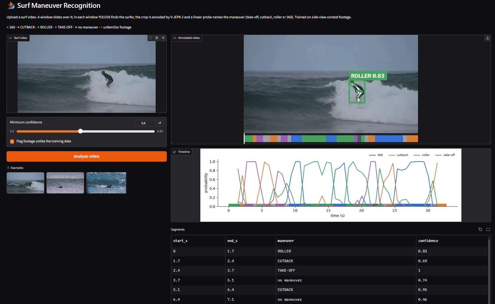
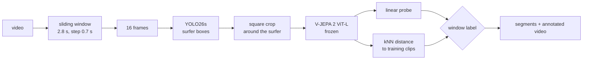
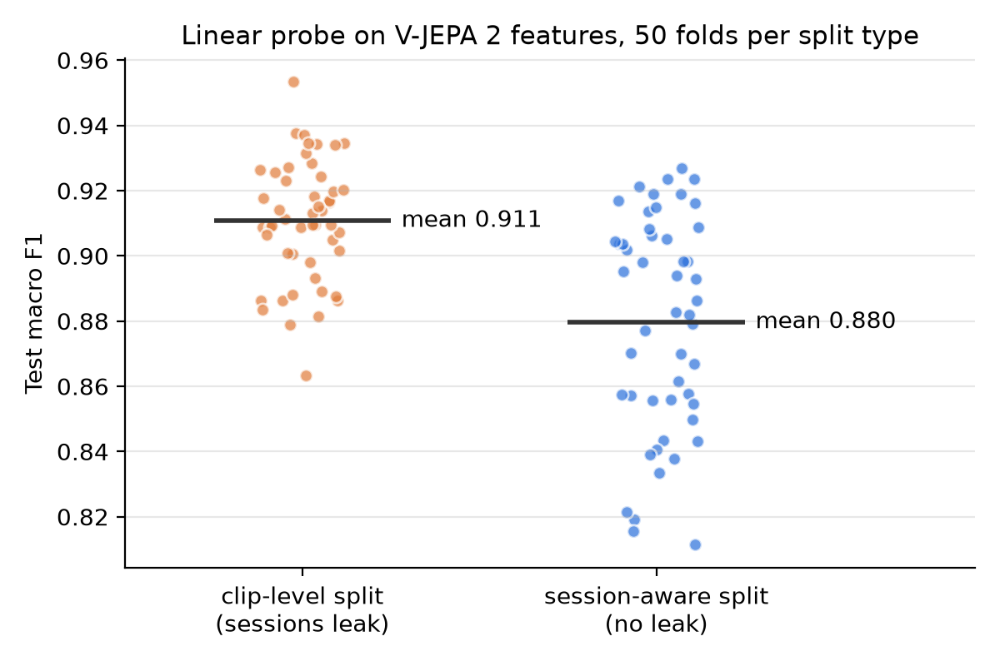
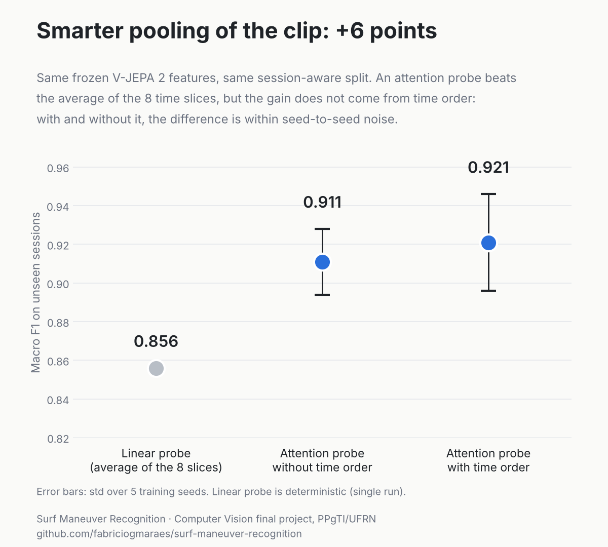
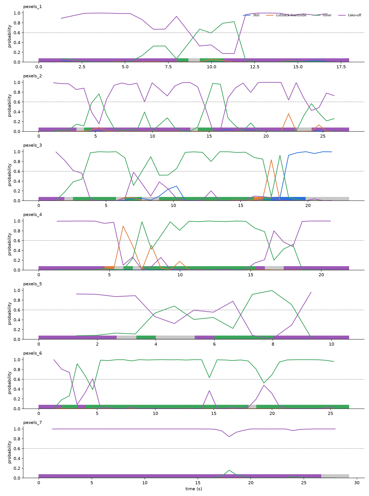
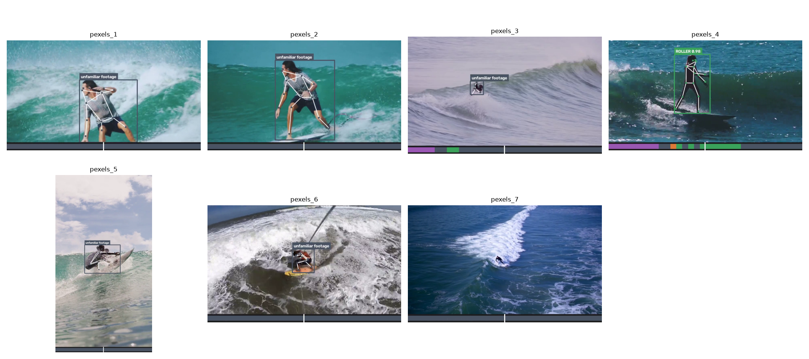

# Surf Maneuver Recognition

**English** | [Português](README.pt-BR.md)

Recognition and temporal segmentation of surf maneuvers in video: frozen V-JEPA 2 video features, surfer detection with YOLO26 and a sliding-window maneuver timeline, served in a Gradio app.

Final project for the Computer Vision course (PPGTI3007), PPgTI/UFRN, 2026.2. Author: Fabricio Guimarães.

**Presentation slides:** [fabriciogmaraes.github.io/surf-maneuver-recognition](https://fabriciogmaraes.github.io/surf-maneuver-recognition/) (Portuguese, with the recorded demo)



## Summary

- **The public dataset leaks surf sessions between train and test.** Clips from the same session (surfer, beach, camera, day) and re-exported copies of the same clip fall on both sides of the original split. Over 50 folds of each kind, the same classifier scores macro F1 **0.911** with clip-level folds and **0.880** with session-aware folds; the gap is positive in 10 of 10 repeats (one-sided Mann-Whitney p = 7.1e-07).
- **Best classifier: a linear probe on frozen V-JEPA 2 features of the surfer crop**, macro F1 **0.896 ± 0.006** on unseen sessions (10 repeats of session-aware 5-fold cross-validation).
- **The model looks at the surfer, not the scene.** Cropping the surfer improves every class; masking the surfer out drops macro F1 to 0.680.
- **Time order is not what helps.** An attention probe over the 8 time slices beats averaging them (+6 points on one split), but the same probe without order information does as well.
- **On unseen footage it only transfers to contest-style video.** Close-ups, slow motion, vertical video and drone shots are misclassified with 0.9–0.99 confidence. A k-nearest-neighbor distance check flags all of them; softmax confidence does not.
- **Main open problem:** the dataset has no "no maneuver" class, so a surfer simply riding the wave is labeled with the majority class (roller).

## 1. Introduction

Surf maneuvers (take-off, cutback, roller, 360) are judged by how the surfer's body and board move through a few seconds of video. Recognizing them automatically could support judging, coaching and highlight extraction, and it is a hard video task: the surfer often occupies a small part of the frame, the camera pans and zooms, water and spray hide the body, and two maneuvers can differ mostly in how a turn unfolds over time.

**Goal:** given a surf video, say which maneuvers happen and when, as a timeline (e.g. 0:12 take-off, 0:15 cutback).

The approach follows a common recipe for small video datasets: a large self-supervised video encoder (V-JEPA 2) is kept frozen and only a small classifier is trained on its features. The work spent as much effort on evaluation as on modeling: auditing the dataset, building a leakage-free split and testing what the model actually relies on.

## 2. Related work

**Surfing.** The closest work is SSD (Qiu et al., 2026), a benchmark for fine-grained temporal phase segmentation in surfing: 3,200 clips of 2D skeletons (17 COCO keypoints) with frame-level labels for 12 phases such as paddle, take-off, cutback and barrel. It works from pose sequences and does not release the RGB videos; this project works from RGB clips and uses pose only for visualization. Mendelman, Massas and Moshe detect and track surfers and waves in fixed beach webcams (Faster R-CNN and SORT) to measure surf conditions rather than maneuvers. To our knowledge, no published study reports results on the Surf Maneuver Recognition dataset used here, so the audit and session-aware baselines in this report appear to be the first.

**Fine-grained sports actions.** FineGym (Shao et al., 2020) and Diving48 (Li et al., 2018) showed that sports actions sharing the same scene and differing only in subtle body movements are hard for standard video models; Diving48 was built specifically so that scene context cannot give the answer away. SkateboardAI (Chen, 2023, preprint) applies video action recognition to skateboarding tricks. The pose-vs-scene test in Section 5.3 follows the same concern: checking that the model looks at the athlete rather than the venue.

**Video foundation models.** V-JEPA 2 (Assran et al., 2025) is pretrained by predicting masked video regions in a learned representation space and is designed to be used frozen with a light probe, which suits a dataset of about a thousand clips. VideoMAE (Tong et al., 2022) is the masked-autoencoder alternative, planned as a comparison but not run. DINOv2 (Oquab et al., 2023) provides image features, used here for near-duplicate detection and as an appearance-only baseline.

**Evaluation pitfalls.** Kapoor and Narayanan (2023) catalog data leakage as a widespread cause of overoptimistic results in machine-learning-based science, including non-independence between training and test samples, which is the situation of the session leakage found here. Barz and Denzler (2020) showed that near-duplicates shared by training and test sets inflate image-classification benchmarks; the same check is applied here to video clips.

**Out-of-distribution detection.** Sun et al. (2022) flag out-of-distribution inputs by their distance to the nearest training features, without assumptions about the feature distribution. The novelty check in this project is a close variant: the mean cosine distance to the 10 nearest training clips, with a threshold taken from the training set and measured across sessions.

## 3. Data

**Surf Maneuver Recognition** (Hugging Face [`2nzi/surf-maneuvers`](https://huggingface.co/datasets/2nzi/surf-maneuvers), Apache 2.0): 1,062 short clips of side-view contest footage, 4 classes, with a train/val/test split. Clips last 2.8 s at the median (10th–90th percentile: 1.9–3.7 s).

| class | clips (after cleaning) |
|---|---|
| roller | 520 |
| cutback-frontside | 235 |
| 360 | 180 |
| take-off | 121 |

### Dataset audit (notebooks 01–02)

- **Session structure.** Clip file numbers follow the order in which clips were cut, so neighboring numbers come from the same session. In the original split 46% of neighboring clips land in different subsets, exactly what a random clip-level split produces.
- **Near-duplicates.** Comparing DINOv2 frame embeddings (cosine similarity) found re-exported copies of the same clip (different color grading or watermark) in train and test, including across naming sources.
- **Label conflicts.** 3 videos are stored under two classes (cutback and roller). The 6 files were removed: **1,056 clips** remain.
- **Session-aware split.** Clips were grouped into **36 sessions** (blocks of contiguous numbers plus links between near-duplicates, as connected components). 34 of the 36 sessions were spread across subsets in the original split. A stratified group split assigns whole sessions to train / val / test: **735 / 85 / 236 clips**. Versioned in [`data/splits.csv`](data/splits.csv).

## 4. Methods



**Video features (notebook 03).** [`facebook/vjepa2-vitl-fpc64-256`](https://huggingface.co/facebook/vjepa2-vitl-fpc64-256) (ViT-L, 326M parameters, float16), frozen. 16 evenly spaced frames per clip give 2,048 tokens: 8 time slices × 256 spatial patches, 1,024 dimensions each. Tokens are averaged over space, keeping one vector per time slice: an (8, 1024) array per clip, cached once (0.38 s per clip on an RTX 3050 Laptop GPU, including video decoding).

**Classifiers (notebooks 04–05).**
- *Linear probe*: standardization + logistic regression with balanced class weights, on the average of the 8 slices.
- *Attention probe*: each slice is projected to 256 dimensions, tagged with a learned positional embedding, mixed by one Transformer layer and pooled by a learned query. The *order-blind* ablation is the same model without positional embeddings. Class-weighted cross-entropy with label smoothing, AdamW, early stopping on validation macro F1, 5 seeds.

**Evaluation (notebook 06).** Macro F1, since classes are imbalanced. Model comparisons use 10 repeats of session-aware 5-fold cross-validation. scikit-learn's `StratifiedGroupKFold` produced only 7 distinct test folds out of 50 across 10 seeds (it sorts groups before shuffling), so folds come from [`random_group_folds`](src/data/splits.py), which visits sessions in a random order and assigns each to the fold where it best balances the classes.

**Surfer localization (notebook 08).** YOLO26s (COCO weights, class person) finds the surfer in each of the 16 frames. Boxes far from the clip's medoid box (other people, false detections) are dropped, and the rest are merged into one fixed square region with a 10% margin. The region is fixed over the clip so the surfer's movement through it is kept. It yields a *surfer-only* clip (crop) and a *scene-only* clip (region painted gray).

**Timeline (notebooks 10–11).** A 2.8 s window (the median clip length) slides with a 0.7 s step. Each window gets one of:
- a maneuver, from the linear probe on the surfer crop;
- **none**, when the top probability is below 0.6 or the surfer is visible in fewer than 8 of the 16 frames;
- **unfamiliar**, when the mean cosine distance to the 10 nearest training clips is above the 95th percentile of the same distance among training clips (measured against clips from other sessions only).

Consecutive windows with the same label are merged into segments, each window covering the time closest to its center.

**Annotated video and app.** YOLO26s-pose draws the surfer's skeleton (illustrative only: the classifier does not use keypoints), the box is colored by the current label, and a timeline bar with a cursor runs below the video. The [Gradio app](app/app.py) wraps the whole pipeline.

## 5. Results

### 5.1 Leakage (notebooks 04, 06)

| split | evaluation | macro F1 |
|---|---|---|
| original (clip-level) | single split | 0.886 |
| session-aware | single split | 0.856 |
| clip-level folds | 50 folds | 0.911 ± 0.018 |
| session-aware folds | 50 folds | 0.880 ± 0.033 |

Linear probe on full-frame V-JEPA 2 features. In clip-level folds, 34 of the 36 sessions have clips on both sides.



Session-aware scores also spread almost twice as much (lowest fold ≈ 0.81): performance depends on which sessions are unseen, which a random split hides.

### 5.2 Linear vs attention probe (notebook 05, session-aware test split)

| classifier | accuracy | macro F1 | cutback F1 |
|---|---|---|---|
| linear probe | 0.852 | 0.856 | 0.725 |
| attention probe, order-blind (5 seeds) | 0.907 ± 0.016 | 0.911 ± 0.017 | 0.844 |
| attention probe, with time order (5 seeds) | 0.919 ± 0.026 | 0.921 ± 0.025 | 0.873 |



- The gain comes from learned pooling: with and without order, the difference is within seed-to-seed noise (2 wins, 1 tie, 2 losses).
- The ordered probe does use order: feeding the slices in reverse lowers its macro F1 by 0.051. But each slice already spans a short stretch of motion, so order adds little.
- Cutback, the class confused with roller, gains the most (cutbacks predicted as roller: 11 of 47 → 7.8 of 47 per run).

### 5.3 What the model relies on (notebooks 07, 09)

Per-class F1, linear probe, 50 session-aware folds:

| input | 360 | cutback | roller | take-off | macro |
|---|---|---|---|---|---|
| DINOv2-small, 3 still frames (appearance only) | 0.673 | 0.683 | 0.770 | 0.899 | 0.756 |
| V-JEPA 2, full frame | 0.851 | 0.836 | 0.891 | 0.944 | 0.880 |
| V-JEPA 2, **surfer-only crop** | **0.872** | **0.848** | **0.908** | **0.955** | **0.896** |
| V-JEPA 2, scene-only (surfer masked) | 0.601 | 0.628 | 0.748 | 0.741 | 0.680 |

- **Cropping helps every class** (+1.1 to +2.1 points; std ≈ 0.006): the encoder works at 256 × 256, so the crop gives the surfer more pixels.
- **Take-off is not a scene shortcut.** Take-off clips are spread over 28 of the 36 sessions and share scenes with other maneuvers; take-off loses 20 points without the surfer, like the others, and keeps 0.899 from still frames: its posture (lying, popping up) is visible in a single frame.
- Motion features matter for the other maneuvers (−12 to −18 points with still frames only), although that comparison also changes the encoder size.
- Scene-only is an upper bound on scene cues, not a pure scene test: the gray region's size and position, spray outside it and camera motion still leak information.
- The person detector finds the surfer in 96.5% of frames; take-off is the hardest class to detect (14.8 of 16 frames), since a surfer lying on the board looks less like a person.

### 5.4 Unseen videos (notebooks 10–11)

Seven free Pexels videos (not redistributed here), annotated by hand by a surfer:

| video | content | without novelty check | flagged unfamiliar |
|---|---|---|---|
| pexels_1, 2 | close tracking shots, slow motion, turns | take-off, 0.9–1.0 ✗ | 100% |
| pexels_3 | side view from the beach, contest-like | take-off → roller → none, plausible | 73% |
| pexels_4 | drop, riding with no maneuver, weak cutback | take-off ✓, roller while riding ✗ | 40% |
| pexels_5 | vertical, slow motion, barrel exit and cutback | take-off / roller ✗ | 100% |
| pexels_6 | kitesurfing (not surfing), high camera | roller 0.99 ✗ | 100% |
| pexels_7 | top-down drone view | take-off 0.99 ✗ | 100% |





- **Montage of 12 held-out test clips** (unseen sessions; classifier and novelty check refit without the test split): 8 of 12 clips get the right majority label. Three of the four errors are take-offs, whose clips are shorter than the window, so every window mixes them with a neighbor.
- **The author's own wave**, filmed from the beach in Natal: mostly flagged unfamiliar, with one 1.4 s segment labeled cutback (0.83) on a turn that resembles, but is not quite, a cutback.

## 6. Critical analysis

- **Evaluation design changed the conclusions more than modeling did.** The leaky split inflates macro F1 by about 3 points, a single split can give a perfect take-off score by luck (24/24, versus 0.944 over 50 folds), and the 85-clip validation set saturates (validation macro F1 0.97–1.00), so it barely guides early stopping.
- **The time-order hypothesis was wrong.** The cutback/roller confusion was expected to need temporal order; a controlled ablation showed that learned pooling, not order, gives the gain.
- **No "no maneuver" class.** Every training clip is a maneuver, so a surfer riding without maneuvering gets a confident maneuver label (pexels_4: roller at 0.94). Distance checks cannot catch this, because the footage looks normal. Real timelines need negative examples (riding, paddling, waiting).
- **Domain shift and overconfidence.** Trained on one camera style, the model fails on close-ups, slow motion, vertical and drone footage, and its softmax confidence stays high. The kNN distance check catches these cases, but its threshold is strict (it also flags 73% of the most contest-like video) and was deliberately not tuned on the 7 test videos.
- **Window length vs maneuver length.** A fixed 2.8 s window mixes neighboring actions for short maneuvers (take-offs in the montage) and covers only part of slow-motion maneuvers.
- **Open checks.** The `Roller_XX` naming source holds 45 clips, all roller, a possible source shortcut. Only 4 classes exist (a barrel exit in pexels_5 has no label). Dataset labels were not re-verified.

## 7. Recommendation

Use the **linear probe on V-JEPA 2 features of the surfer crop, with the kNN novelty check** (as in the app). It has the best macro F1 under the strictest evaluation (0.896 over 50 session-aware folds), is deterministic, trains in seconds and needs no hyperparameter search. The attention probe was better on a single split (0.921 vs 0.856 on full-frame features), but its gain did not come from temporal modeling, it varies across seeds and it was not evaluated on surfer crops or repeated folds; it is the first candidate for future comparison.

## 8. Not done and future work

Planned at the start and left out for time: VideoMAE fine-tuning as a second model, training with 25% of the data, re-encoding truly reversed videos, SAM 3 / LibreYOLO as alternative trackers, Label Studio annotation of longer videos, training on the NPAD supercomputer, and the SSD surfing skeleton dataset. Next steps:

- collect footage with a "no maneuver" class (and own sessions filmed in Natal) to make real timelines possible;
- evaluate the attention probe on surfer crops under repeated session-aware folds;
- use the pose keypoints as an input, toward feedback on how a maneuver was executed;
- check the `Roller_XX` source shortcut.

## Reproduce

```bash
uv venv --python 3.11
uv pip install -r requirements.txt   # PyTorch with CUDA: install the cu128 build first
```

1. Download the dataset into `data/raw/data-split/` (`train/`, `val/`, `test/`, one folder per class).
2. Run the notebooks in order (01 → 11). Features and boxes are cached in `data/processed/` (not versioned); V-JEPA 2 extraction takes about 7 minutes per clip version on an RTX 3050 Laptop GPU.
3. Start the app from the project root: `python app/app.py`, then open http://127.0.0.1:7860.

All experiments ran on an RTX 3050 Laptop GPU (6 GB). NPAD/UFRN access (`npad/`) was set up for heavier training, which this report did not need.

## Notebooks

| notebook | content |
|---|---|
| [01](notebooks/01_data_exploration.ipynb) | data exploration: class balance, durations, sample frames |
| [02](notebooks/02_session_split.ipynb) | sessions, near-duplicates, label conflicts, session-aware split |
| [03](notebooks/03_vjepa2_features.ipynb) | V-JEPA 2 feature extraction |
| [04](notebooks/04_linear_probe.ipynb) | linear probe, original vs session-aware split |
| [05](notebooks/05_temporal_probe.ipynb) | attention probe and time-order ablation |
| [06](notebooks/06_leakage_repeated_splits.ipynb) | leakage over 50 repeated folds |
| [07](notebooks/07_takeoff_shortcut.ipynb) | take-off shortcut check, appearance vs motion |
| [08](notebooks/08_surfer_detection.ipynb) | YOLO26 surfer detection, surfer-only and scene-only clips |
| [09](notebooks/09_pose_vs_scene.ipynb) | full frame vs surfer-only vs scene-only |
| [10](notebooks/10_timeline_external_videos.ipynb) | timeline on unseen videos, novelty check |
| [11](notebooks/11_annotated_videos.ipynb) | annotated videos, held-out test montage |

## Repository structure

- `app/` — Gradio demo app
- `data/` — local data (only `splits.csv` is versioned)
- `models/` — saved linear probe and novelty check used by the app
- `notebooks/` — experiments, each ending with a Findings section
- `npad/` — SLURM job scripts for the NPAD supercomputer
- `reports/figures/` — figures used in this README
- `src/data/` — clip inventory, video reading, features, session-aware folds, surfer crop
- `src/models/` — V-JEPA 2 encoder, probes, training and evaluation
- `src/inference/` — sliding-window timeline, novelty check, annotated video

## Licenses and data

- Code: MIT (see [LICENSE](LICENSE)).
- Surf Maneuver Recognition dataset: Apache 2.0. Clips are not redistributed; the app screenshot shows a frame from its test split.
- External test videos: Pexels License. The videos are not redistributed; annotated frames appear in the figures.
- V-JEPA 2 weights (Meta) and Ultralytics YOLO26 (AGPL-3.0) keep their own licenses.

## References

- Assran, M. et al. (2025). V-JEPA 2: Self-Supervised Video Models Enable Understanding, Prediction and Planning. Meta AI.
- Barz, B. and Denzler, J. (2020). Do We Train on Test Data? Purging CIFAR of Near-Duplicates. *Journal of Imaging*, 6(6), 41.
- Chen, H. (2023). SkateboardAI: The Coolest Video Action Recognition for Skateboarding. arXiv:2311.11467 (preprint).
- Kapoor, S. and Narayanan, A. (2023). Leakage and the reproducibility crisis in machine-learning-based science. *Patterns*, 4(9).
- Li, Y., Li, Y. and Vasconcelos, N. (2018). RESOUND: Towards Action Recognition without Representation Bias (Diving48). *ECCV*.
- Mendelman, H., Massas, T. and Moshe, Y. Analysis of Waves and Human Interaction Using Beach Webcams. Signal and Image Processing Laboratory, Technion (OCEANS 2023).
- Oquab, M. et al. (2023). DINOv2: Learning Robust Visual Features without Supervision. Meta AI.
- Qiu, M. et al. (2026). SSD: A Dataset and Benchmark for Fine-Grained Temporal Phase Segmentation in Surfing Sports. IEEE DataPort. doi:10.21227/w41m-k422.
- Shao, D., Zhao, Y., Dai, B. and Lin, D. (2020). FineGym: A Hierarchical Video Dataset for Fine-grained Action Understanding. *CVPR*.
- Sun, Y., Ming, Y., Zhu, X. and Li, Y. (2022). Out-of-Distribution Detection with Deep Nearest Neighbors. *ICML*, PMLR 162.
- Tong, Z., Song, Y., Wang, J. and Wang, L. (2022). VideoMAE: Masked Autoencoders are Data-Efficient Learners for Self-Supervised Video Pre-Training. *NeurIPS*.
- Ultralytics YOLO26 documentation.
- Course material by Prof. Helton Maia: Deep Learning, ch. 4 (video classification with V-JEPA 2), and Computer Vision, ch. 5 (YOLO).

## Acknowledgments

Prof. Helton Maia for the course and material, and NPAD/UFRN for computing access.
