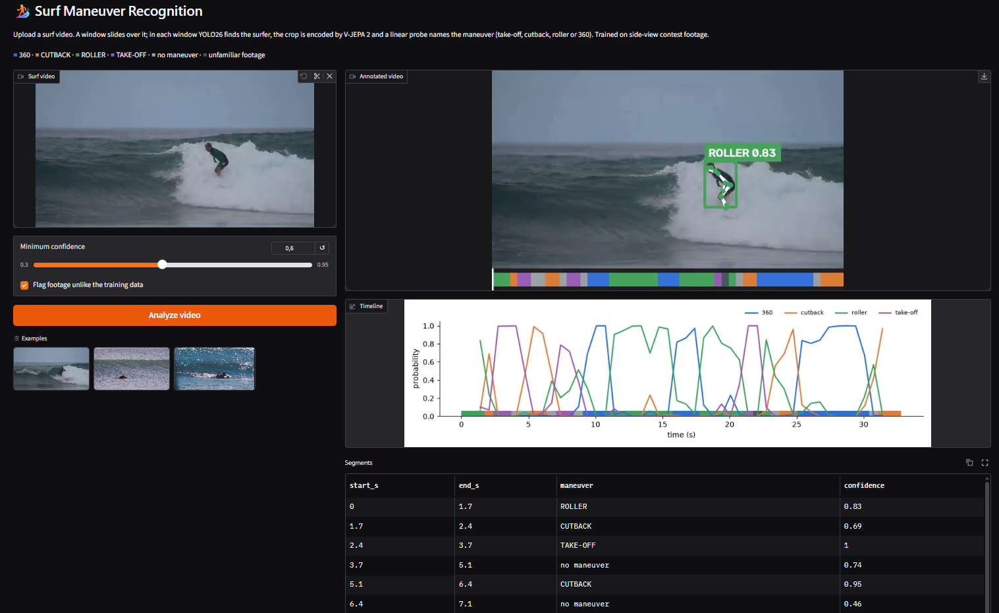
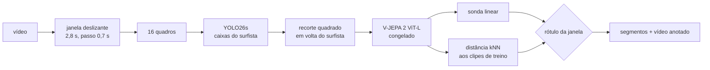
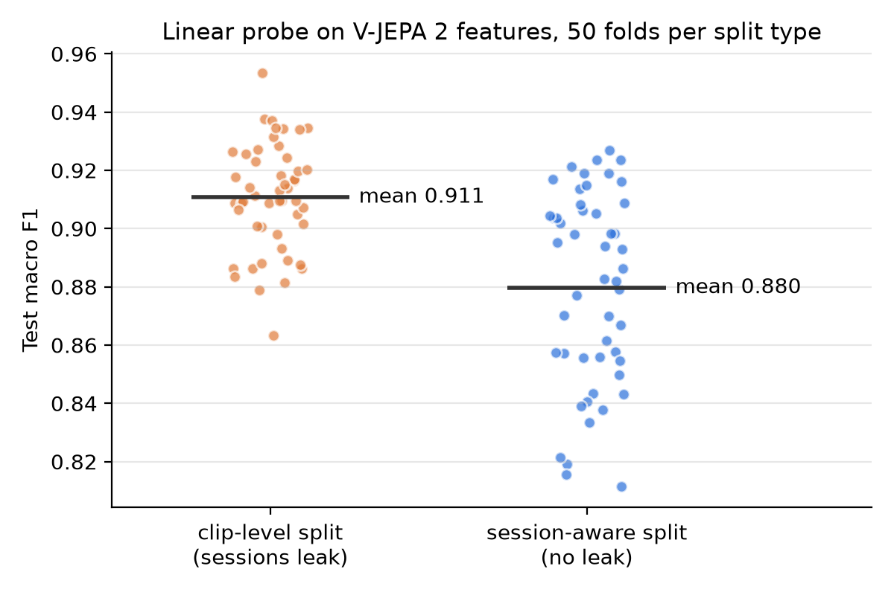
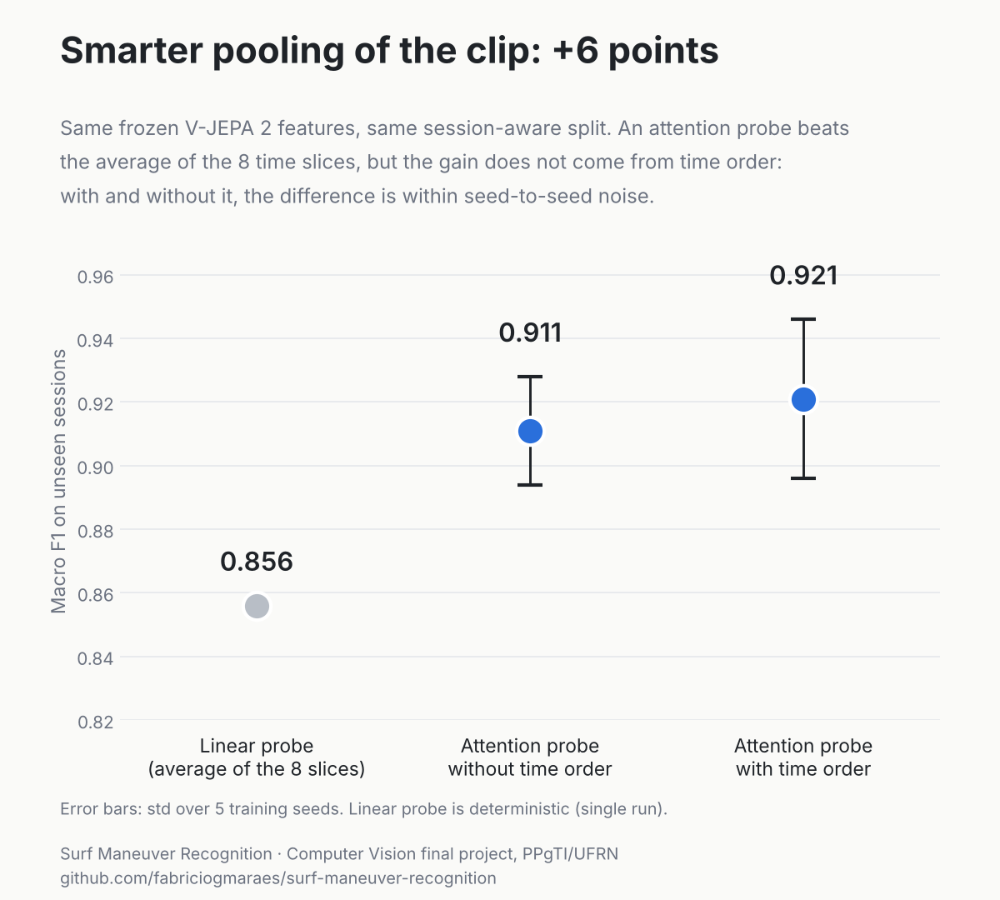
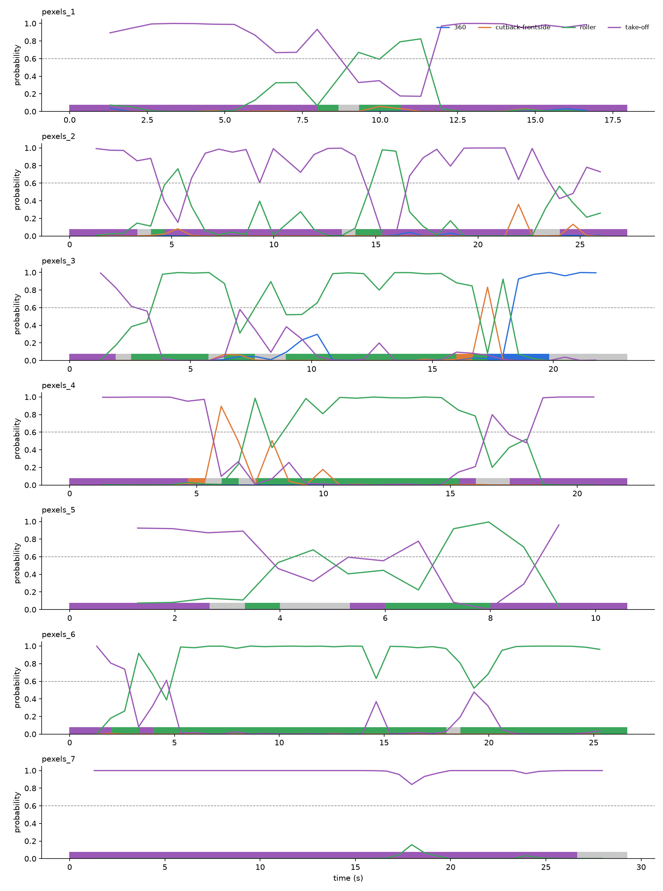
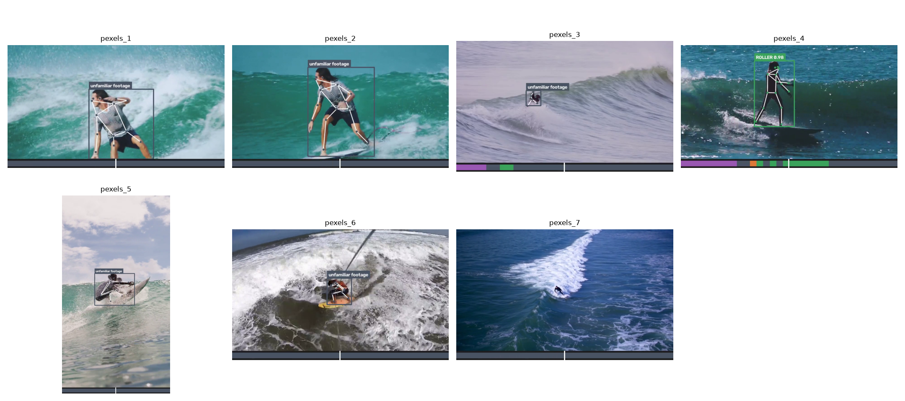

# Surf Maneuver Recognition

[English](README.md) | **Português**

Reconhecimento e segmentação temporal de manobras de surf em vídeo: features de vídeo do V-JEPA 2 congelado, detecção do surfista com YOLO26 e uma linha do tempo de manobras por janela deslizante, disponível num app Gradio.

Trabalho final da disciplina de Visão Computacional (PPGTI3007), PPgTI/UFRN, 2026.2. Autor: Fabricio Guimarães.

**Slides da apresentação:** [fabriciogmaraes.github.io/surf-maneuver-recognition](https://fabriciogmaraes.github.io/surf-maneuver-recognition/) (em português e inglês, com a demonstração gravada)



## Resumo

- **O dataset público vaza sessões de surf entre treino e teste.** Clipes da mesma sessão (surfista, praia, câmera, dia) e cópias reexportadas do mesmo clipe caem dos dois lados da divisão original. Em 50 folds de cada tipo, o mesmo classificador marca macro F1 **0,911** com folds por clipe e **0,880** com folds por sessão; a diferença é positiva em 10 de 10 repetições (Mann-Whitney unilateral, p = 7,1e-07).
- **Melhor classificador: uma sonda linear sobre features do V-JEPA 2 congelado no recorte do surfista**, macro F1 **0,896 ± 0,006** em sessões nunca vistas (10 repetições de validação cruzada de 5 folds por sessão).
- **O modelo olha para o surfista, não para a cena.** Recortar o surfista melhora todas as classes; apagar o surfista derruba o macro F1 para 0,680.
- **A ordem temporal não é o que ajuda.** Uma sonda de atenção sobre as 8 fatias de tempo supera a média delas (+6 pontos em uma divisão), mas a mesma sonda sem informação de ordem vai tão bem quanto.
- **Em vídeos novos, só transfere para imagens no estilo de campeonato.** Close-ups, câmera lenta, vídeo vertical e drone são classificados errado com confiança de 0,9–0,99. Um teste de distância aos vizinhos mais próximos (kNN) sinaliza todos eles; a confiança do softmax não.
- **Principal problema em aberto:** o dataset não tem a classe "sem manobra", então um surfista só andando na onda recebe a classe majoritária (roller).

## 1. Introdução

Manobras de surf (take-off, cutback, roller, 360) são avaliadas pelo movimento do corpo e da prancha ao longo de poucos segundos de vídeo. Reconhecê-las automaticamente pode apoiar julgamento, treino e geração de melhores momentos, e é uma tarefa difícil de vídeo: o surfista costuma ocupar uma parte pequena do quadro, a câmera se move e dá zoom, água e spray escondem o corpo, e duas manobras podem diferir principalmente em como uma virada se desenvolve no tempo.

**Objetivo:** dado um vídeo de surf, dizer quais manobras acontecem e quando, como uma linha do tempo (por exemplo, 0:12 take-off, 0:15 cutback).

A abordagem segue uma receita comum para datasets pequenos de vídeo: um grande codificador de vídeo autossupervisionado (V-JEPA 2) fica congelado e só um classificador pequeno é treinado sobre as features dele. O trabalho dedicou tanto esforço à avaliação quanto à modelagem: auditar o dataset, montar uma divisão sem vazamento e testar em que o modelo realmente se apoia.

## 2. Trabalhos relacionados

**Surf.** O trabalho mais próximo é o SSD (Qiu et al., 2026), um benchmark de segmentação temporal fina de fases no surf: 3.200 clipes de esqueletos 2D (17 pontos COCO) com rótulos por quadro para 12 fases, como remada, take-off, cutback e tubo. Ele trabalha com sequências de pose e não disponibiliza os vídeos RGB; este projeto trabalha com clipes RGB e usa a pose só para visualização. Mendelman, Massas e Moshe detectam e rastreiam surfistas e ondas em webcams fixas de praia (Faster R-CNN e SORT) para medir condições do mar, não manobras. Até onde sabemos, nenhum estudo publicado reporta resultados no dataset Surf Maneuver Recognition usado aqui, então a auditoria e os resultados com divisão por sessão deste relatório parecem ser os primeiros.

**Ações esportivas finas.** FineGym (Shao et al., 2020) e Diving48 (Li et al., 2018) mostraram que ações esportivas que compartilham a mesma cena e diferem só em detalhes do movimento do corpo são difíceis para modelos de vídeo comuns; o Diving48 foi construído justamente para que o contexto da cena não entregue a resposta. O SkateboardAI (Chen, 2023, preprint) aplica reconhecimento de ações em vídeo a manobras de skate. O teste pose × cena da Seção 5.3 segue a mesma preocupação: verificar se o modelo olha para o atleta e não para o local.

**Modelos fundacionais de vídeo.** O V-JEPA 2 (Assran et al., 2025) é pré-treinado prevendo regiões mascaradas do vídeo num espaço de representação aprendido e foi pensado para ser usado congelado com uma sonda leve, o que combina com um dataset de cerca de mil clipes. O VideoMAE (Tong et al., 2022) é a alternativa de autoencoder mascarado, planejada como comparação mas não executada. O DINOv2 (Oquab et al., 2023) fornece features de imagem, usadas aqui para detectar quase-duplicatas e como linha de base só de aparência.

**Armadilhas de avaliação.** Kapoor e Narayanan (2023) catalogam o vazamento de dados como uma causa comum de resultados otimistas demais em ciência baseada em aprendizado de máquina, incluindo a falta de independência entre amostras de treino e teste, que é a situação do vazamento de sessões encontrado aqui. Barz e Denzler (2020) mostraram que quase-duplicatas compartilhadas entre treino e teste inflam benchmarks de classificação de imagens; a mesma verificação é aplicada aqui a clipes de vídeo.

**Detecção de dados fora da distribuição.** Sun et al. (2022) identificam entradas fora da distribuição pela distância às features de treino mais próximas, sem supor uma distribuição para as features. O teste de novidade deste projeto é uma variante próxima: a distância de cosseno média aos 10 clipes de treino mais próximos, com um limite tirado do próprio conjunto de treino e medido entre sessões diferentes.

## 3. Dados

**Surf Maneuver Recognition** (Hugging Face [`2nzi/surf-maneuvers`](https://huggingface.co/datasets/2nzi/surf-maneuvers), Apache 2.0): 1.062 clipes curtos de imagens laterais de campeonato, 4 classes, com divisão treino/validação/teste. A duração mediana é 2,8 s (percentis 10–90: 1,9–3,7 s).

| classe | clipes (após limpeza) |
|---|---|
| roller | 520 |
| cutback-frontside | 235 |
| 360 | 180 |
| take-off | 121 |

### Auditoria do dataset (notebooks 01–02)

- **Estrutura de sessões.** Os números dos arquivos seguem a ordem em que os clipes foram cortados, então números vizinhos vêm da mesma sessão. Na divisão original, 46% dos clipes vizinhos caem em subconjuntos diferentes, exatamente o que uma divisão aleatória por clipe produz.
- **Quase-duplicatas.** Comparando embeddings de quadros do DINOv2 (similaridade de cosseno), foram encontradas cópias reexportadas do mesmo clipe (outra correção de cor ou marca d'água) no treino e no teste, inclusive entre fontes de nomes diferentes.
- **Rótulos conflitantes.** 3 vídeos estão guardados em duas classes (cutback e roller). Os 6 arquivos foram removidos: restam **1.056 clipes**.
- **Divisão por sessão.** Os clipes foram agrupados em **36 sessões** (blocos de números contíguos mais ligações entre quase-duplicatas, como componentes conectados). Na divisão original, 34 das 36 sessões estavam espalhadas entre subconjuntos. Uma divisão estratificada por grupos coloca sessões inteiras em treino / validação / teste: **735 / 85 / 236 clipes**. Versionada em [`data/splits.csv`](data/splits.csv).

## 4. Métodos



**Features de vídeo (notebook 03).** [`facebook/vjepa2-vitl-fpc64-256`](https://huggingface.co/facebook/vjepa2-vitl-fpc64-256) (ViT-L, 326M de parâmetros, float16), congelado. 16 quadros igualmente espaçados por clipe geram 2.048 tokens: 8 fatias de tempo × 256 blocos espaciais, com 1.024 dimensões cada. Os tokens são promediados no espaço, mantendo um vetor por fatia de tempo: um array (8, 1024) por clipe, calculado uma única vez (0,38 s por clipe numa RTX 3050 Laptop, incluindo a decodificação do vídeo).

**Classificadores (notebooks 04–05).**
- *Sonda linear*: padronização + regressão logística com pesos de classe balanceados, sobre a média das 8 fatias.
- *Sonda de atenção*: cada fatia é projetada para 256 dimensões, marcada com um embedding de posição aprendido, misturada por uma camada Transformer e agregada por uma consulta aprendida. A ablação *sem ordem* é o mesmo modelo sem os embeddings de posição. Entropia cruzada com pesos por classe e label smoothing, AdamW, parada antecipada pelo macro F1 de validação, 5 sementes.

**Avaliação (notebook 06).** Macro F1, porque as classes são desbalanceadas. As comparações entre modelos usam 10 repetições de validação cruzada de 5 folds por sessão. O `StratifiedGroupKFold` do scikit-learn gerou só 7 folds de teste distintos em 50, ao longo de 10 sementes (ele ordena os grupos antes de embaralhar), então os folds vêm de [`random_group_folds`](src/data/splits.py), que percorre as sessões em ordem aleatória e coloca cada uma no fold onde ela melhor equilibra as classes.

**Localização do surfista (notebook 08).** O YOLO26s (pesos COCO, classe pessoa) encontra o surfista em cada um dos 16 quadros. Caixas longe da caixa medoide do clipe (outras pessoas, detecções falsas) são descartadas, e as restantes são unidas numa região quadrada fixa com margem de 10%. A região é fixa ao longo do clipe para preservar o deslocamento do surfista dentro dela. Ela gera um clipe *só surfista* (recorte) e um clipe *só cena* (região pintada de cinza).

**Linha do tempo (notebooks 10–11).** Uma janela de 2,8 s (a duração mediana dos clipes) desliza com passo de 0,7 s. Cada janela recebe um destes rótulos:
- uma manobra, pela sonda linear no recorte do surfista;
- **none** (sem manobra), quando a maior probabilidade fica abaixo de 0,6 ou o surfista aparece em menos de 8 dos 16 quadros;
- **unfamiliar** (filmagem estranha), quando a distância de cosseno média aos 10 clipes de treino mais próximos passa do percentil 95 da mesma distância entre clipes de treino (medida só contra clipes de outras sessões).

Janelas consecutivas com o mesmo rótulo viram segmentos, e cada janela cobre o trecho de tempo mais perto do seu centro.

**Vídeo anotado e app.** O YOLO26s-pose desenha o esqueleto do surfista (só ilustrativo: o classificador não usa os pontos do corpo), a caixa ganha a cor do rótulo atual, e uma barra de linha do tempo com cursor corre embaixo do vídeo. O [app Gradio](app/app.py) junta o pipeline inteiro.

## 5. Resultados

### 5.1 Vazamento (notebooks 04, 06)

| divisão | avaliação | macro F1 |
|---|---|---|
| original (por clipe) | uma divisão | 0,886 |
| por sessão | uma divisão | 0,856 |
| folds por clipe | 50 folds | 0,911 ± 0,018 |
| folds por sessão | 50 folds | 0,880 ± 0,033 |

Sonda linear sobre features do V-JEPA 2 no quadro inteiro. Nos folds por clipe, 34 das 36 sessões têm clipes dos dois lados.



Os resultados por sessão também variam quase o dobro (pior fold ≈ 0,81): o desempenho depende de quais sessões ficam de fora, e uma divisão aleatória esconde isso.

### 5.2 Sonda linear × sonda de atenção (notebook 05, teste da divisão por sessão)

| classificador | acurácia | macro F1 | F1 do cutback |
|---|---|---|---|
| sonda linear | 0,852 | 0,856 | 0,725 |
| sonda de atenção, sem ordem (5 sementes) | 0,907 ± 0,016 | 0,911 ± 0,017 | 0,844 |
| sonda de atenção, com ordem temporal (5 sementes) | 0,919 ± 0,026 | 0,921 ± 0,025 | 0,873 |



- O ganho vem da agregação aprendida: com e sem ordem, a diferença fica dentro da variação entre sementes (2 vitórias, 1 empate, 2 derrotas).
- A sonda com ordem usa a ordem: dar as fatias invertidas reduz o macro F1 dela em 0,051. Mas cada fatia já cobre um pequeno trecho de movimento, então a ordem acrescenta pouco.
- O cutback, a classe confundida com o roller, é o que mais ganha (cutbacks previstos como roller: 11 de 47 → 7,8 de 47 por rodada).

### 5.3 Em que o modelo se apoia (notebooks 07, 09)

F1 por classe, sonda linear, 50 folds por sessão:

| entrada | 360 | cutback | roller | take-off | macro |
|---|---|---|---|---|---|
| DINOv2-small, 3 quadros parados (só aparência) | 0,673 | 0,683 | 0,770 | 0,899 | 0,756 |
| V-JEPA 2, quadro inteiro | 0,851 | 0,836 | 0,891 | 0,944 | 0,880 |
| V-JEPA 2, **recorte só do surfista** | **0,872** | **0,848** | **0,908** | **0,955** | **0,896** |
| V-JEPA 2, só cena (surfista apagado) | 0,601 | 0,628 | 0,748 | 0,741 | 0,680 |

- **O recorte ajuda todas as classes** (+1,1 a +2,1 pontos; desvio ≈ 0,006): o codificador trabalha em 256 × 256, então o recorte dá mais pixels ao surfista.
- **O take-off não é um atalho de cena.** Os clipes de take-off estão espalhados em 28 das 36 sessões e dividem cenas com outras manobras; o take-off perde 20 pontos sem o surfista, como as outras, e mantém 0,899 com quadros parados: a postura (deitado, levantando) aparece num único quadro.
- As features de movimento importam para as outras manobras (−12 a −18 pontos só com quadros parados), embora essa comparação também mude o tamanho do codificador.
- O "só cena" é um teto para as pistas de cena, não um teste de cena pura: o tamanho e a posição da região cinza, o spray fora dela e o movimento da câmera ainda vazam informação.
- O detector de pessoas encontra o surfista em 96,5% dos quadros; o take-off é a classe mais difícil de detectar (14,8 de 16 quadros), porque um surfista deitado na prancha parece menos uma pessoa.

### 5.4 Vídeos nunca vistos (notebooks 10–11)

Sete vídeos gratuitos do Pexels (não redistribuídos aqui), anotados à mão por um surfista:

| vídeo | conteúdo | sem teste de novidade | sinalizado como estranho |
|---|---|---|---|
| pexels_1, 2 | close acompanhando o surfista, câmera lenta, viradas | take-off, 0,9–1,0 ✗ | 100% |
| pexels_3 | lateral, da praia, parecido com campeonato | take-off → roller → none, plausível | 73% |
| pexels_4 | drop, andando sem manobra, cutback fraco | take-off ✓, roller enquanto anda ✗ | 40% |
| pexels_5 | vertical, câmera lenta, saída de tubo e cutback | take-off / roller ✗ | 100% |
| pexels_6 | kitesurf (não é surf), câmera alta | roller 0,99 ✗ | 100% |
| pexels_7 | drone de cima | take-off 0,99 ✗ | 100% |





- **Montagem de 12 clipes do teste** (sessões nunca vistas; classificador e teste de novidade retreinados sem o teste): 8 de 12 clipes recebem o rótulo majoritário correto. Três dos quatro erros são take-offs, cujos clipes são mais curtos que a janela, então toda janela os mistura com um vizinho.
- **A própria onda do autor**, filmada da areia em Natal: quase toda sinalizada como estranha, com um segmento de 1,4 s rotulado cutback (0,83) numa virada que lembra, mas não é exatamente, um cutback.

## 6. Análise crítica

- **O desenho da avaliação mudou mais as conclusões do que a modelagem.** A divisão com vazamento infla o macro F1 em cerca de 3 pontos, uma única divisão pode dar um take-off perfeito por sorte (24/24, contra 0,944 em 50 folds), e a validação de 85 clipes satura (macro F1 de validação 0,97–1,00), então quase não orienta a parada antecipada.
- **A hipótese da ordem temporal estava errada.** Esperava-se que a confusão cutback/roller precisasse de ordem temporal; uma ablação controlada mostrou que o ganho vem da agregação aprendida, não da ordem.
- **Não existe a classe "sem manobra".** Todo clipe de treino é uma manobra, então um surfista andando sem manobrar recebe um rótulo de manobra com confiança alta (pexels_4: roller a 0,94). Testes de distância não pegam esse caso, porque a filmagem parece normal. Linhas do tempo reais precisam de exemplos negativos (andando, remando, esperando).
- **Mudança de domínio e excesso de confiança.** Treinado num único estilo de câmera, o modelo erra em close-ups, câmera lenta, vídeo vertical e drone, e a confiança do softmax continua alta. O teste de distância kNN pega esses casos, mas o limite é rígido (também sinaliza 73% do vídeo mais parecido com campeonato) e, de propósito, não foi ajustado nos 7 vídeos de teste.
- **Tamanho da janela × duração da manobra.** Uma janela fixa de 2,8 s mistura ações vizinhas em manobras curtas (os take-offs da montagem) e cobre só parte de manobras em câmera lenta.
- **Verificações pendentes.** A fonte de nomes `Roller_XX` tem 45 clipes, todos roller, um possível atalho de fonte. Só existem 4 classes (a saída de tubo do pexels_5 não tem rótulo). Os rótulos do dataset não foram reverificados.

## 7. Recomendação

Usar a **sonda linear sobre features do V-JEPA 2 no recorte do surfista, com o teste de novidade kNN** (como no app). Ela tem o melhor macro F1 na avaliação mais rigorosa (0,896 em 50 folds por sessão), é determinística, treina em segundos e não precisa de busca de hiperparâmetros. A sonda de atenção foi melhor numa única divisão (0,921 contra 0,856 no quadro inteiro), mas o ganho dela não veio da modelagem temporal, varia entre sementes e ela não foi avaliada no recorte do surfista nem em folds repetidos; é a primeira candidata para comparações futuras.

## 8. O que não foi feito e trabalhos futuros

Planejados no início e deixados de fora por tempo: ajuste fino do VideoMAE como segundo modelo, treino com 25% dos dados, recodificar vídeos realmente invertidos, SAM 3 / LibreYOLO como rastreadores alternativos, anotação de vídeos longos no Label Studio, treino no supercomputador NPAD e o dataset de esqueletos SSD. Próximos passos:

- coletar filmagens com a classe "sem manobra" (e sessões próprias filmadas em Natal) para tornar possíveis linhas do tempo reais;
- avaliar a sonda de atenção no recorte do surfista com folds por sessão repetidos;
- usar os pontos da pose como entrada, rumo a um retorno sobre como a manobra foi executada;
- verificar o atalho de fonte `Roller_XX`.

## Como reproduzir

```bash
uv venv --python 3.11
# Primeiro o PyTorch com CUDA 12.8 (a versão padrão do PyPI no Windows é só CPU)
uv pip install torch==2.11.0 torchvision==0.26.0 --index-url https://download.pytorch.org/whl/cu128
uv pip install -r requirements.txt
```

1. Baixe e descompacte o dataset; o zip já contém `data-split/` (`train/`, `val/`, `test/`, uma pasta por classe):

   ```bash
   hf download 2nzi/surf-maneuvers data-split.zip --repo-type dataset --local-dir data/raw
   unzip data/raw/data-split.zip -d data/raw   # PowerShell: Expand-Archive data/raw/data-split.zip data/raw
   ```
2. Rode os notebooks em ordem (01 → 11). Features e caixas ficam em cache em `data/processed/` (não versionado); a extração do V-JEPA 2 leva uns 7 minutos por versão do dataset (quadro inteiro, recorte do surfista, só cena) numa RTX 3050 Laptop, cerca de 0,38 s por clipe.
3. Suba o app a partir da raiz do projeto: `python app/app.py` e abra http://127.0.0.1:7860.

Todos os experimentos rodaram numa RTX 3050 Laptop (6 GB). O acesso ao NPAD/UFRN (`npad/`) foi configurado para treinos mais pesados, que este relatório não precisou.

## Notebooks

| notebook | conteúdo |
|---|---|
| [01](notebooks/01_data_exploration.ipynb) | exploração dos dados: balanço de classes, durações, quadros de exemplo |
| [02](notebooks/02_session_split.ipynb) | sessões, quase-duplicatas, rótulos conflitantes, divisão por sessão |
| [03](notebooks/03_vjepa2_features.ipynb) | extração de features do V-JEPA 2 |
| [04](notebooks/04_linear_probe.ipynb) | sonda linear, divisão original × por sessão |
| [05](notebooks/05_temporal_probe.ipynb) | sonda de atenção e ablação da ordem temporal |
| [06](notebooks/06_leakage_repeated_splits.ipynb) | vazamento em 50 folds repetidos |
| [07](notebooks/07_takeoff_shortcut.ipynb) | atalho do take-off, aparência × movimento |
| [08](notebooks/08_surfer_detection.ipynb) | detecção do surfista com YOLO26, clipes só surfista e só cena |
| [09](notebooks/09_pose_vs_scene.ipynb) | quadro inteiro × só surfista × só cena |
| [10](notebooks/10_timeline_external_videos.ipynb) | linha do tempo em vídeos nunca vistos, teste de novidade |
| [11](notebooks/11_annotated_videos.ipynb) | vídeos anotados, montagem do teste |

Os notebooks e o código estão em inglês.

## Estrutura do repositório

- `app/` — app Gradio de demonstração
- `data/` — dados locais (só o `splits.csv` é versionado)
- `models/` — sonda linear e teste de novidade salvos, usados pelo app
- `notebooks/` — experimentos, cada um terminando com uma seção de Findings
- `npad/` — notas de acesso ao supercomputador NPAD/UFRN (configurado, não usado neste trabalho)
- `reports/figures/` — figuras usadas neste README
- `src/data/` — inventário de clipes, leitura de vídeo, features, folds por sessão, recorte do surfista
- `src/models/` — codificador V-JEPA 2, sondas, treino e avaliação
- `src/inference/` — linha do tempo por janela deslizante, teste de novidade, vídeo anotado

## Licenças e dados

- Código: MIT (veja [LICENSE](LICENSE)).
- Dataset Surf Maneuver Recognition: Apache 2.0. Os clipes não são redistribuídos; o print do app mostra um quadro do conjunto de teste.
- Vídeos externos de teste: Licença Pexels. Os vídeos não são redistribuídos; quadros anotados aparecem nas figuras.
- Os pesos do V-JEPA 2 (Meta) e o Ultralytics YOLO26 (AGPL-3.0) mantêm as próprias licenças.

## Referências

- Assran, M. et al. (2025). V-JEPA 2: Self-Supervised Video Models Enable Understanding, Prediction and Planning. Meta AI.
- Barz, B. e Denzler, J. (2020). Do We Train on Test Data? Purging CIFAR of Near-Duplicates. *Journal of Imaging*, 6(6), 41.
- Chen, H. (2023). SkateboardAI: The Coolest Video Action Recognition for Skateboarding. arXiv:2311.11467 (preprint).
- Kapoor, S. e Narayanan, A. (2023). Leakage and the reproducibility crisis in machine-learning-based science. *Patterns*, 4(9).
- Li, Y., Li, Y. e Vasconcelos, N. (2018). RESOUND: Towards Action Recognition without Representation Bias (Diving48). *ECCV*.
- Mendelman, H., Massas, T. e Moshe, Y. Analysis of Waves and Human Interaction Using Beach Webcams. Signal and Image Processing Laboratory, Technion (OCEANS 2023).
- Oquab, M. et al. (2023). DINOv2: Learning Robust Visual Features without Supervision. Meta AI.
- Qiu, M. et al. (2026). SSD: A Dataset and Benchmark for Fine-Grained Temporal Phase Segmentation in Surfing Sports. IEEE DataPort. doi:10.21227/w41m-k422.
- Shao, D., Zhao, Y., Dai, B. e Lin, D. (2020). FineGym: A Hierarchical Video Dataset for Fine-grained Action Understanding. *CVPR*.
- Sun, Y., Ming, Y., Zhu, X. e Li, Y. (2022). Out-of-Distribution Detection with Deep Nearest Neighbors. *ICML*, PMLR 162.
- Tong, Z., Song, Y., Wang, J. e Wang, L. (2022). VideoMAE: Masked Autoencoders are Data-Efficient Learners for Self-Supervised Video Pre-Training. *NeurIPS*.
- Documentação do Ultralytics YOLO26.
- Material do curso do Prof. Helton Maia: Deep Learning, cap. 4 (classificação de vídeo com V-JEPA 2), e Visão Computacional, cap. 5 (YOLO).

## Agradecimentos

Ao Prof. Helton Maia pela disciplina e pelo material, e ao NPAD/UFRN pelo acesso computacional.
